<h1 align="center">harry@github:~$ <code>whoami</code></h1>

<p align="center">
  <a href="https://harrycpc.github.io/harrycpc/"></a><br>
  <br>
  <a href="https://harrycpc.github.io/harrycpc/"></a>
</p>

[](https://visitcount.itsvg.in)

## `$ cat stack.txt`

<table>
  <tr>
    <td><code>devops</code></td>
    <td></td>
  </tr>
  <tr>
    <td><code>learning</code></td>
    <td> </td>
  </tr>
  <tr>
    <td><code>web</code></td>
    <td></td>
  </tr>
</table>

## `$ ./stats`

<!-- stats.svg + snake.svg are built daily by .github/workflows/profile-assets.yml into the `output` branch -->


[](https://git.io/streak-stats)
[](https://git.io/streak-stats)
[](https://git.io/streak-stats)


## `$ cat motto.txt`

```console
$ cat motto.txt
Automate the boring stuff, document the rest.
```
